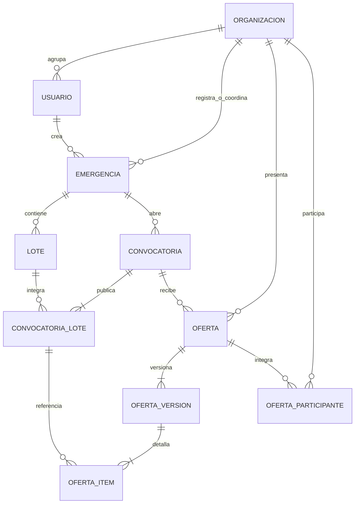

# Base de datos de RescueSync

Este documento describe el esquema PostgreSQL vigente luego de aplicar todas las
migraciones Alembic hasta `20260928_0006`. Las fuentes ejecutables son
`backend/alembic/versions/` y los modelos SQLAlchemy de
`backend/app/db/models/`.

El esquema persiste identidades locales, emergencias, lotes, convocatorias y
ofertas. Bonita conserva el estado del proceso BPM, mientras que PostgreSQL
guarda los identificadores necesarios para correlacionar cada emergencia con su
caso.

## Cadena de migraciones

```text
20260915_0001
  -> 20260917_0002
  -> 20260927_0003
  -> 20260927_0004
  -> 20260928_0005
  -> 20260928_0006
```

### `20260915_0001_crear_esquema_inicial.py`

Es la migración base. Crea las diez tablas del dominio, sus claves foráneas,
restricciones, índices y triggers de integridad. También crea los tipos enum
iniciales:

- `tipo_organizacion`: `MUNICIPIO`, `CENTRO_COORDINADOR`, `ONG`.
- `rol_usuario`: `OPERADOR_MUNICIPAL`, `COORDINADOR_REGIONAL`,
  `REPRESENTANTE_ONG`, `AUDITOR_DIRECTIVO`.
- `gravedad_emergencia`: `BAJA`, `MEDIA`, `ALTA`, `CRITICA`.
- `estado_emergencia`: `REGISTRADA`, `EN_COORDINACION`, `PUBLICADA`,
  `EN_EVALUACION`, `EN_EJECUCION`, `RESUELTA`, `CANCELADA`.
- `estado_sincronizacion_bonita`: `PENDIENTE`, `VINCULADA`, `ERROR`,
  `RESULTADO_DESCONOCIDO`.
- `estado_lote`: `BORRADOR`, `PUBLICADO`, `CERRADO`, `CANCELADO`.
- `estado_convocatoria`: `ABIERTA`, `CERRADA`, `CANCELADA`.
- `estado_oferta`: `BORRADOR`, `PRESENTADA`, `EN_VALIDACION`, `VALIDADA`,
  `ADJUDICADA`, `NO_ADJUDICADA`, `RETIRADA`.
- `tipo_aporte`: `RECURSO`, `PERSONAL`, `MIXTO`.
- `tipo_participacion`: `LIDER`, `MIEMBRO`.

Las tablas creadas son `organizacion`, `usuario`, `emergencia`, `lote`,
`convocatoria`, `convocatoria_lote`, `oferta`, `oferta_version`, `oferta_item`
y `oferta_participante`. Sus columnas se detallan en la sección
[Esquema final](#esquema-final).

Además, esta migración incorpora validaciones relacionales mediante triggers:

- el rol operativo del usuario debe coincidir con el tipo de su organización;
- una emergencia debe pertenecer a un municipio y solo puede asignarse a una
  organización de tipo centro coordinador;
- un lote publicado debe pertenecer a la misma emergencia que su convocatoria;
- la creadora y las participantes de una oferta deben ser ONGs;
- un ítem debe pertenecer a la misma convocatoria que la oferta que lo contiene.

El `downgrade()` elimina triggers, tablas, índices y enums en orden inverso.

### `20260917_0002_administracion_usuarios.py`

Agrega la administración local de cuentas:

- incorpora `ADMINISTRADOR` al enum `rol_usuario`;
- agrega `usuario.requiere_cambio_password`, que obliga a reemplazar una
  contraseña temporal;
- agrega `usuario.version_sesion`, que permite invalidar cookies ya emitidas al
  cambiar una contraseña o desactivar una cuenta;
- exige que `version_sesion` sea positiva;
- reemplaza el trigger de usuario para que tanto `AUDITOR_DIRECTIVO` como
  `ADMINISTRADOR` no tengan organización, y para que los roles operativos sigan
  asociados al tipo correcto.

Su `downgrade()` convierte administradores en auditores antes de reconstruir el
enum sin `ADMINISTRADOR`, y elimina las dos columnas nuevas.

### `20260927_0003_sincronizacion_bonita_convocatoria.py`

Agrega trazabilidad de la tarea humana de Bonita `Generar lotes de necesidades`.
Crea el enum `estado_tarea_bonita` con `PENDIENTE`, `EN_PROGRESO`, `COMPLETADA`,
`ERROR` y `RESULTADO_DESCONOCIDO`, y suma a `convocatoria`:

- `bonita_generar_lotes_estado`: resultado conocido de la sincronización;
- `bonita_generar_lotes_ultimo_error`: mensaje seguro del último fallo;
- `bonita_generar_lotes_ultimo_intento_en`: fecha del último intento.

Esto separa la publicación local, que se confirma primero, de la posterior
ejecución de la tarea en Bonita. El `downgrade()` elimina las columnas y el enum.

### `20260927_0004_claim_id_sincronizacion_bonita.py`

Agrega `convocatoria.bonita_generar_lotes_claim_id`. Es un identificador opaco
de 32 caracteres que determina qué intento concurrente es dueño de una
sincronización `EN_PROGRESO`. Evita que un intento lento sobrescriba el resultado
de otro que retomó un reclamo vencido. El `downgrade()` elimina la columna.

### `20260928_0005_reforzar_sincronizacion_y_ofertas.py`

Refuerza dos invariantes:

- agrega `emergencia.bonita_claim_id`, equivalente al reclamo de convocatoria
  pero aplicado al inicio o reconciliación de la instancia BPM;
- reemplaza la función del trigger de `oferta_item` para exigir, además de la
  pertenencia a la convocatoria correcta, que el lote continúe en estado
  `PUBLICADO`.

El `downgrade()` restaura la versión anterior del trigger y elimina
`bonita_claim_id`.

### `20260928_0006_notificaciones_tiempo_real.py`

Crea el enum `tipo_notificacion` y la tabla `notificacion`. Cada fila pertenece
a un usuario concreto, conserva la novedad aunque no estuviera conectado y usa
la pareja `(usuario_id, clave_evento)` para tolerar reintentos de callbacks sin
duplicar avisos. Los índices por usuario/fecha y usuario/lectura sostienen el
buzón y su contador.

### `20260929_0007_oferta_unica_y_cantidad_maxima.py`

Agrega una unicidad parcial sobre `(convocatoria_id, ong_creadora_id)` para que
cada ONG mantenga una sola oferta vigente por convocatoria. Si ya había
duplicados, conserva todas las filas y marca las anteriores mediante
`fusionada_en_oferta_id`, apuntándolas a la más reciente. También amplía el
trigger de `oferta_item` para impedir que una escritura nueva supere
`convocatoria_lote.cantidad_publicada`; los datos históricos quedan intactos.

## Esquema final

Las claves foráneas operativas usan `ON DELETE RESTRICT`: la trazabilidad
histórica impide borrar una entidad que ya es referenciada. La única excepción
es el buzón personal, que usa `ON DELETE CASCADE` al eliminar una cuenta. Los campos `timestamptz`
almacenan instantes con zona horaria y la aplicación trabaja en UTC.

### `organizacion`

Representa una entidad participante del sistema.

| Columna | Tipo / nulabilidad | Uso |
| --- | --- | --- |
| `id` | `bigint`, PK | Identificador interno. |
| `tipo` | `tipo_organizacion`, no nulo | Distingue municipio, centro coordinador u ONG. |
| `nombre` | `varchar(160)`, no nulo | Nombre visible; no puede quedar vacío. |
| `activa` | `boolean`, no nulo, default `true` | Baja lógica de la organización. |
| `creada_en` | `timestamptz`, no nulo, default `now()` | Fecha de alta. |
| `actualizada_en` | `timestamptz`, no nulo, default `now()` | Última modificación. |

El índice único `uq_organizacion_tipo_nombre` evita duplicar un mismo nombre
dentro del mismo tipo de organización.

### `usuario`

Guarda la identidad, credenciales y autorización local.

| Columna | Tipo / nulabilidad | Uso |
| --- | --- | --- |
| `id` | `bigint`, PK | Identificador de la cuenta. |
| `organizacion_id` | `bigint`, FK, nullable | Organización operativa; debe ser nula para auditor y administrador. |
| `email` | `varchar(320)`, no nulo | Identificador de inicio de sesión. |
| `password_hash` | `varchar(255)`, no nulo | Hash Argon2; la base rechaza valores que no comiencen con `$argon2`. |
| `rol` | `rol_usuario`, no nulo | Define las operaciones permitidas por RBAC. |
| `activo` | `boolean`, no nulo, default `true` | Baja lógica sin perder trazabilidad. |
| `requiere_cambio_password` | `boolean`, no nulo, default `false` | Marca credenciales temporales. Agregada en `0002`. |
| `version_sesion` | `integer`, no nulo, default `1` | Invalida sesiones anteriores; debe ser positiva. Agregada en `0002`. |
| `creado_en` | `timestamptz`, no nulo, default `now()` | Fecha de alta. |
| `actualizado_en` | `timestamptz`, no nulo, default `now()` | Última modificación. |

`uq_usuario_email_normalizado` aplica unicidad sobre `lower(email)`. El trigger
`trg_usuario_organizacion` valida la correspondencia entre rol y organización.

### `notificacion`

Guarda el buzón durable que complementa la entrega por WebSocket.

| Columna | Tipo / nulabilidad | Uso |
| --- | --- | --- |
| `id` | `bigint`, PK | Identificador de la novedad. |
| `usuario_id` | `bigint`, FK, no nulo | Destinatario autorizado. |
| `clave_evento` | `varchar(180)`, no nulo | Clave idempotente del evento de dominio. |
| `tipo` | `tipo_notificacion`, no nulo | Define qué consulta debe refrescar el frontend. |
| `titulo` | `varchar(140)`, no nulo | Resumen visible. |
| `mensaje` | `text`, no nulo | Explicación segura para el usuario. |
| `ruta` | `varchar(255)`, nullable | Navegación interna relativa. |
| `emergencia_id` | `bigint`, FK, nullable | Contexto del incidente de Bonita; `SET NULL` si se elimina la emergencia. |
| `tarea_bonita_nombre` | `varchar(160)`, nullable | Nombre observado por el monitor al generar el aviso. |
| `leida_en` | `timestamptz`, nullable | Momento en que el destinatario leyó la novedad. |
| `creada_en` | `timestamptz`, no nulo | Momento de creación. |

La unicidad por usuario y clave hace idempotentes los avisos generados por
conectores reintentables de Bonita.

La migración `20261020_0017` agrega el contexto del incidente y actualiza los
destinos de ofertas recibidas, convocatorias e incidentes a `/notificaciones/{id}`.
En los incidentes anteriores recupera emergencia y nombre del formato conocido
del mensaje, validando la existencia de la emergencia. Conserva destinatarios,
claves de evento, mensajes, fechas y estado de lectura. Su downgrade restaura
los destinos genéricos y retira las dos columnas nuevas.

### `emergencia`

Conserva el alta municipal, su estado local y la correlación con Bonita.

| Columna | Tipo / nulabilidad | Uso |
| --- | --- | --- |
| `id` | `bigint`, PK | Identificador enviado a Bonita como `idEmergencia`. |
| `municipio_id` | `bigint`, FK, no nulo | Municipio dueño del alta. |
| `centro_coordinador_id` | `bigint`, FK, nullable | Centro que tomó la coordinación. |
| `creada_por_usuario_id` | `bigint`, FK, no nulo | Operador que registró la emergencia. |
| `gravedad` | `gravedad_emergencia`, no nulo | Severidad declarada. |
| `zona` | `varchar(255)`, no nulo | Área afectada; no puede quedar vacía. |
| `prioridad` | `integer`, nullable | Puntuación de 1 a 10 del alta municipal. Los registros anteriores a la migración conservan `NULL`. |
| `descripcion` | `text`, no nulo | Descripción inicial; no puede quedar vacía. |
| `estado` | `estado_emergencia`, no nulo, default `REGISTRADA` | Estado funcional local. |
| `bonita_process_definition_id` | `bigint`, nullable | Definición habilitada usada al iniciar el caso. |
| `bonita_process_instance_id` | `bigint`, nullable, único | `caseId`/instancia vinculada; debe ser positivo. |
| `bonita_process_version` | `varchar(50)`, nullable | Versión del proceso que creó el caso. |
| `bonita_sync` | `estado_sincronizacion_bonita`, no nulo, default `PENDIENTE` | Resultado conocido de la vinculación. |
| `bonita_ultimo_error` | `text`, nullable | Último error seguro, apto para mostrar o reintentar. |
| `bonita_ultimo_intento_en` | `timestamptz`, nullable | Momento del último intento de vinculación. |
| `bonita_claim_id` | `varchar(32)`, nullable | Dueño temporal del intento concurrente. Agregada en `0005`. |
| `version` | `integer`, no nulo, default `1` | Campo de versionado optimista, siempre positivo. |
| `creada_en` | `timestamptz`, no nulo, default `now()` | Fecha de registro. |
| `actualizada_en` | `timestamptz`, no nulo, default `now()` | Última modificación. |

Una emergencia `VINCULADA` debe tener instancia de Bonita. Los índices por
municipio/estado, centro/estado y sincronización aceleran las bandejas y tareas
de operación. El trigger `trg_emergencia_organizaciones` valida los tipos de
organización.

### `lote`

Describe una necesidad cuantificada dentro de una emergencia.

| Columna | Tipo / nulabilidad | Uso |
| --- | --- | --- |
| `id` | `bigint`, PK | Identificador del lote. |
| `emergencia_id` | `bigint`, FK, no nulo | Emergencia a la que pertenece. |
| `creado_por_usuario_id` | `bigint`, FK, no nulo | Coordinador que lo registró. |
| `tipo_necesidad` | `varchar(160)`, no nulo | Nombre de la capacidad nacional elegida; los lotes locales anteriores conservan su texto. |
| `descripcion` | `text`, nullable | Detalle complementario. |
| `cantidad_requerida` | `numeric(14,3)`, no nulo | Cantidad solicitada; debe ser positiva. |
| `unidad` | `varchar(40)`, no nulo | Unidad de medida; no puede quedar vacía. |
| `estado` | `estado_lote`, no nulo, default `BORRADOR` | Controla edición y publicación. |
| `version` | `integer`, no nulo, default `1` | Control optimista de ediciones concurrentes. |
| `creado_en` | `timestamptz`, no nulo, default `now()` | Fecha de alta. |
| `actualizado_en` | `timestamptz`, no nulo, default `now()` | Última modificación. |

El índice `ix_lote_emergencia_estado` sirve para recuperar lotes editables o
publicados por emergencia.

### `convocatoria`

Representa una ronda temporal de recepción de ofertas.

| Columna | Tipo / nulabilidad | Uso |
| --- | --- | --- |
| `id` | `bigint`, PK | Identificador de la ronda. |
| `emergencia_id` | `bigint`, FK, no nulo | Emergencia convocante. |
| `numero` | `integer`, no nulo | Número secuencial dentro de la emergencia. |
| `estado` | `estado_convocatoria`, no nulo, default `ABIERTA` | Habilita o impide nuevas ofertas. |
| `publicada_en` | `timestamptz`, no nulo, default `now()` | Inicio local de la ronda. |
| `cierra_en` | `timestamptz`, no nulo | Fin de la ventana; Bonita lo confirma mediante callback. |
| `cerrada_en` | `timestamptz`, nullable | Cierre efectivo; obligatorio si el estado es `CERRADA`. |
| `creada_en` | `timestamptz`, no nulo, default `now()` | Fecha de creación del registro. |
| `bonita_generar_lotes_estado` | `estado_tarea_bonita`, no nulo, default `PENDIENTE` | Estado de la tarea `Generar lotes`. Agregada en `0003`. |
| `bonita_generar_lotes_ultimo_error` | `text`, nullable | Último error seguro de esa tarea. Agregada en `0003`. |
| `bonita_generar_lotes_ultimo_intento_en` | `timestamptz`, nullable | Fecha del último intento. Agregada en `0003`. |
| `bonita_generar_lotes_claim_id` | `varchar(32)`, nullable | Dueño temporal del intento. Agregada en `0004`. |

La pareja `(emergencia_id, numero)` es única, `cierra_en` debe ser posterior a
`publicada_en` y un índice único parcial permite como máximo una convocatoria
`ABIERTA` por emergencia.

### `convocatoria_lote`

Es el snapshot de cada lote incluido en una ronda. Permite preservar qué se
publicó aunque el modelo admita nuevas rondas en el futuro.

| Columna | Tipo / nulabilidad | Uso |
| --- | --- | --- |
| `convocatoria_id` | `bigint`, PK/FK | Convocatoria que publica el lote. |
| `lote_id` | `bigint`, PK/FK | Lote publicado. |
| `cantidad_publicada` | `numeric(14,3)`, no nulo | Cantidad visible en esa ronda; debe ser positiva. |
| `unidad_publicada` | `varchar(40)`, no nulo | Unidad visible en esa ronda. |

La clave primaria es compuesta. El trigger
`trg_convocatoria_lote_emergencia` impide asociar un lote de otra emergencia.

### `oferta`

Es la identidad estable de una propuesta presentada por una ONG.

| Columna | Tipo / nulabilidad | Uso |
| --- | --- | --- |
| `id` | `bigint`, PK | Identificador de la oferta. |
| `convocatoria_id` | `bigint`, FK, no nulo | Ronda a la que responde. |
| `ong_creadora_id` | `bigint`, FK, no nulo | ONG propietaria de la propuesta. |
| `creada_por_usuario_id` | `bigint`, FK, no nulo | Usuario que la registró. |
| `fusionada_en_oferta_id` | `bigint`, FK propia, nullable | Oferta vigente que reemplaza un duplicado histórico previo a `0007`. |
| `estado` | `estado_oferta`, no nulo, default `BORRADOR` | Ciclo de vida de la propuesta. |
| `version_actual` | `integer`, no nulo, default `1` | Revisión vigente del contenido. |
| `version_bloqueo` | `integer`, no nulo, default `1` | Control optimista para futuras modificaciones. |
| `creada_en` | `timestamptz`, no nulo, default `now()` | Fecha de alta. |
| `actualizada_en` | `timestamptz`, no nulo, default `now()` | Última modificación. |

Ambas versiones deben ser positivas. La pareja
`(convocatoria_id, ong_creadora_id)` es única entre filas no fusionadas: las
modificaciones generan versiones nuevas de la misma oferta. Los índices por convocatoria/estado y
ONG/estado sostienen la consolidación y la vista “Mis ofertas”. El trigger
`trg_oferta_ong` exige que `ong_creadora_id` corresponda a una ONG.

### `oferta_version`

Conserva revisiones inmutables del contenido de una oferta.

| Columna | Tipo / nulabilidad | Uso |
| --- | --- | --- |
| `id` | `bigint`, PK | Identificador de la revisión. |
| `oferta_id` | `bigint`, FK, no nulo | Oferta estable a la que pertenece. |
| `creada_por_usuario_id` | `bigint`, FK, no nulo | Autor de la revisión. |
| `numero` | `integer`, no nulo | Secuencia positiva dentro de la oferta. |
| `observaciones` | `text`, nullable | Comentario general de la propuesta. |
| `presentada_en` | `timestamptz`, nullable | Momento en que dejó de ser borrador. |
| `creada_en` | `timestamptz`, no nulo, default `now()` | Fecha de creación de la revisión. |

`(oferta_id, numero)` es único y existe un índice descendente para localizar la
versión más reciente. La API crea directamente la versión 1 presentada y cada
edición agrega una revisión inmutable posterior.

### `oferta_item`

Detalla cuánto y qué tipo de ayuda se ofrece para un lote publicado.

| Columna | Tipo / nulabilidad | Uso |
| --- | --- | --- |
| `id` | `bigint`, PK | Identificador del ítem. |
| `oferta_version_id` | `bigint`, FK, no nulo | Revisión que contiene el ítem. |
| `convocatoria_id` | `bigint`, no nulo | Parte de la FK compuesta al lote publicado. |
| `lote_id` | `bigint`, no nulo | Parte de la FK compuesta al lote publicado. |
| `tipo` | `tipo_aporte`, no nulo | Recurso, personal o aporte mixto. |
| `descripcion` | `text`, no nulo | Detalle concreto del aporte. |
| `cantidad_ofrecida` | `numeric(14,3)`, no nulo | Cantidad positiva que no supera la publicada. |
| `unidad` | `varchar(40)`, no nulo | Debe coincidir con la unidad publicada. |

La FK `(convocatoria_id, lote_id)` apunta a `convocatoria_lote`; una versión no
puede repetir el mismo lote. El trigger reforzado por `0005` también comprueba
que la versión corresponda a una oferta de esa convocatoria, que el lote siga
`PUBLICADO` y que la cantidad no exceda el snapshot publicado.

### `oferta_participante`

Relaciona una oferta con las ONGs que la integran. En la Entrega 2 la oferta
básica usa `oferta.ong_creadora_id`; esta tabla deja preparado el soporte de
consorcios.

| Columna | Tipo / nulabilidad | Uso |
| --- | --- | --- |
| `oferta_id` | `bigint`, PK/FK | Oferta conjunta. |
| `ong_id` | `bigint`, PK/FK | ONG participante. |
| `rol` | `tipo_participacion`, no nulo | `LIDER` o `MIEMBRO`. |
| `incorporada_en` | `timestamptz`, no nulo, default `now()` | Fecha de incorporación. |

La clave primaria compuesta evita duplicar participantes, el índice único
parcial permite una sola líder por oferta y el trigger
`trg_oferta_participante_ong` valida que cada participante sea una ONG.

## Relaciones principales



## Archivos relacionados

- Migraciones: `backend/alembic/versions/`.
- Registro de metadata para Alembic: `backend/alembic/env.py` y
  `backend/app/db/models/__init__.py`.
- Modelos y enums: `backend/app/db/models/`.
- Sesión PostgreSQL: `backend/app/db/session.py`.
- Casos de uso: `backend/app/services/`.
- Pruebas del esquema: `backend/tests/test_database_models.py`.
