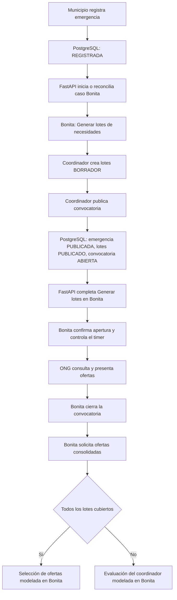

# Flujo actual de RescueSync

> Actualización 20/10/2026: [perfiles informativos](./perfiles-competencia.md) reemplaza las
> reglas de certificación, habilitación previa y clasificación por riesgo de este
> documento. Las referencias a esas reglas describen el comportamiento anterior.


Este documento describe el comportamiento implementado a la fecha, desde el
alta de una emergencia hasta el último punto integrado entre React, FastAPI,
PostgreSQL y Bonita. También separa las etapas que existen en el proceso BPM
1.2 pero todavía no tienen soporte completo en la aplicación.

Las fuentes de verdad consultadas son `Trabajo integrador 2026.pdf`,
`Grooming Etapa 2.pdf`, el artefacto `RescueSync-1.2.bar` y el código vigente.
El alcance operativo corresponde a la Entrega 2; la API Nacional, el bloqueo de
recursos y el cierre completo pertenecen a etapas posteriores.

## Responsabilidad de cada componente

- **React** presenta las pantallas según el rol y consume REST y WebSocket de FastAPI.
- **FastAPI** autentica, autoriza, valida CSRF, ejecuta los casos de uso y adapta
  todas las llamadas hacia o desde Bonita.
- **PostgreSQL** es la fuente de verdad local para usuarios, emergencias, lotes,
  convocatorias, ofertas y notificaciones.
- **Bonita** orquesta el recorrido BPM y es dueño del temporizador de la ventana
  de ofertas.
- **API Nacional** está fuera del alcance actual. No recibe borradores ni
  ofertas preliminares.

Todas las rutas indicadas a continuación llevan el prefijo `/api/v1`.

## Roles actuales

| Rol | Participación en el flujo actual |
| --- | --- |
| `OPERADOR_MUNICIPAL` | Registra emergencias, consulta las de su municipio y reintenta su vinculación con Bonita. |
| `COORDINADOR_REGIONAL` | Consulta emergencias disponibles y las asignadas a su centro, crea/edita/elimina lotes y publica la convocatoria. |
| `REPRESENTANTE_ONG` | Consulta convocatorias y lotes publicados, registra una oferta parcial por convocatoria, la modifica durante la ventana y consulta las ofertas de su ONG. |
| `AUDITOR_DIRECTIVO` | Consulta el dashboard global con indicadores locales, tiempos de Bonita y exportación CSV/JSON. |
| `ADMINISTRADOR` | Gestiona usuarios, roles, organizaciones y contraseñas; no interviene en el recorrido operativo de una emergencia. |
| Bonita | Usa un token técnico y el `caseId` raíz para ejecutar callbacks internos; no usa una sesión de usuario. |

La autorización real está en `backend/app/core/permissions.py` y se aplica con
las dependencias de `backend/app/api/dependencies.py`. Ocultar una pantalla en
React no reemplaza esos controles.

## Resumen del tramo implementado



## Paso a paso

### 0. Sesión y contexto del rol

El usuario inicia sesión con `POST /auth/login`. FastAPI establece una cookie
firmada `HttpOnly`; `GET /auth/me` vuelve a cargar usuario, organización y rol
desde PostgreSQL y entrega el token CSRF. Las operaciones que modifican estado
exigen además `X-CSRF-Token`.

Archivos principales:

- frontend: `frontend/src/pages/LoginPage.tsx`,
  `frontend/src/hooks/useSession.ts`, `frontend/src/api/auth.ts`;
- backend: `backend/app/api/routes/auth.py`,
  `backend/app/services/auth.py`, `backend/app/core/security.py`.

### 1. El municipio registra la emergencia

El dashboard municipal presenta dos tarjetas: **Registrar emergencia** abre
`/emergencias/nueva` y **Mis emergencias** abre `/mis-emergencias`. Ambas vistas
permiten volver al inicio y navegar a la otra funcionalidad. El formulario conserva
la confirmación del alta y permite registrar otra emergencia; el listado permite
consultar estados y reintentar la vinculación con Bonita.

El operador completa gravedad, zona y descripción en
`frontend/src/components/EmergenciaForm.tsx`. El hook
`frontend/src/hooks/useRegistrarEmergencia.ts` llama a:

```http
POST /api/v1/emergencias
```

`backend/app/api/routes/emergencias.py` exige rol `OPERADOR_MUNICIPAL` y CSRF.
`backend/app/services/emergencias.py` confirma primero una fila en `emergencia`
con:

- el municipio y usuario autenticados;
- `estado = REGISTRADA`;
- `bonita_sync = PENDIENTE`.

En la misma transacción se crean las notificaciones para los coordinadores
activos. Después del commit, el WebSocket actualiza sus bandejas de emergencias.

Si la inserción local es válida, no se revierte aunque Bonita esté caído. La
bandeja del municipio se consulta con `GET /emergencias` y se muestra mediante
`frontend/src/components/BandejaEmergencias.tsx`.

### 2. FastAPI inicia y vincula el caso de Bonita

Después del commit local, `backend/app/services/vinculacion_bonita.py` usa el
cliente compartido de `backend/app/integrations/bonita/cliente.py`. Resuelve la
definición habilitada por nombre y versión e inicia el proceso con el contrato de
`backend/app/integrations/bonita/contratos.py`:

| Variable Bonita | Origen local |
| --- | --- |
| `idEmergencia` | `emergencia.id` |
| `gravedad` | `emergencia.gravedad` |
| `zona` | `emergencia.zona` |
| `descripcion` | `emergencia.descripcion` |
| `municipioId` | `emergencia.municipio_id` |

Cuando Bonita responde, se guardan definición, `caseId` y versión del proceso,
y `bonita_sync` pasa a `VINCULADA`. Un fallo definitivo deja `ERROR`; un timeout
posterior al POST puede dejar `RESULTADO_DESCONOCIDO`.

El municipio puede ejecutar:

```http
POST /api/v1/emergencias/{emergencia_id}/reintentar-bonita
```

Antes de repetir un POST incierto, el servicio busca un caso existente mediante
el índice de Bonita `idEmergencia`. `emergencia.bonita_claim_id` serializa
intentos concurrentes para no duplicar casos.

En el `.bar`, el caso recorre `Inicio` → `Inicializar caso de emergencia` →
`Recibir Alerta` → la tarea humana `Generar lotes de necesidades`, asignada al
actor **Coordinador Regional**.

### 3. El centro coordinador genera lotes

El inicio del coordinador presenta dos tarjetas que abren vistas independientes:
**Emergencias pendientes** (`/emergencias/pendientes`) lista únicamente emergencias
sin lotes; **Emergencias no pendientes** (`/emergencias/con-lotes`) lista las que
tienen al menos un lote, incluso en borrador, y permite filtrar por estado. El
filtro se conserva en el parámetro `estado` de la URL.

Ambas consultan `GET /emergencias`, cuya respuesta incluye `tiene_lotes`, calculado
en bloque a partir de los lotes persistidos. El backend permite ver las emergencias
`REGISTRADA` sin centro y todas las asignadas al propio centro, en cualquier estado;
las de otros centros siguen excluidas. Crear el primer lote retira la emergencia
de pendientes aunque siga `REGISTRADA`; eliminar el último borrador la devuelve.
Los lotes se muestran como consulta cuando la emergencia ya no admite edición.

Desde `frontend/src/pages/LotesPage.tsx`, el formulario
`frontend/src/components/LotesForm.tsx` usa:

| Endpoint | Efecto |
| --- | --- |
| `GET /emergencias/{id}/lotes` | Recupera los lotes existentes del centro asignado. Consultar no reclama una emergencia libre. |
| `POST /emergencias/{id}/lotes` | Crea o edita varios lotes `BORRADOR`; el primer guardado asigna la emergencia al centro. |
| `DELETE /emergencias/{id}/lotes/{lote_id}` | Elimina físicamente un lote solo mientras siga en borrador. |
| `GET /emergencias/catalogos/capacidades-nacionales` | Carga automáticamente las capacidades del selector del formulario. |

Para crear o actualizar un lote desde la interfaz se elige una capacidad nacional
y se indica la cantidad. El nombre y la unidad provienen del catálogo; la unidad
se muestra como solo lectura. La descripción es opcional. Los borradores
anteriores sin vínculo conservan sus datos y requieren seleccionar una capacidad
antes de volver a guardarse.

Las rutas están en `backend/app/api/routes/lotes.py` y el caso de uso en
`backend/app/services/lotes.py`. Las ediciones exigen la versión vigente para
evitar sobrescrituras concurrentes. Guardar lotes no publica la convocatoria y,
en la implementación actual, tampoco cambia `emergencia.estado`: continúa en
`REGISTRADA` hasta la publicación.

### 4. El coordinador publica la convocatoria

La acción explícita del formulario llama a:

```http
POST /api/v1/emergencias/{emergencia_id}/publicar
```

`backend/app/services/convocatorias.py` bloquea la emergencia y los borradores y
ejecuta una única transacción local:

1. exige que el centro autenticado sea el asignado;
2. exige al menos un lote `BORRADOR`;
3. crea una `convocatoria` `ABIERTA` con número secuencial;
4. copia cantidad y unidad en `convocatoria_lote` para conservar el snapshot;
5. cambia los lotes a `PUBLICADO`;
6. cambia la emergencia a `PUBLICADA`.

La misma transacción crea la novedad de convocatoria para las ONGs y el cambio
de estado para los operadores del municipio dueño. Los avisos municipales de
publicación y paso a evaluación incluyen la zona y la descripción de la
emergencia; **Ver detalle** lleva a `/emergencias/{id}/ejecucion`. La migración
`20261020_0016` corrige también esos avisos existentes sin cambiar sus fechas ni
marcarlos como leídos.

Inicialmente `cierra_en` recibe una fecha provisoria de dos horas. Bonita la
reemplaza luego por la fecha real de su timer.

Después del commit, `backend/app/services/publicacion_bonita.py` busca la tarea
`Generar lotes de necesidades`, la asigna al usuario técnico
`coordinador.regional` y la completa. El resultado se registra en los campos
`bonita_generar_lotes_*` de la convocatoria. Si falla, la publicación local se
conserva y repetir el mismo endpoint reintenta la sincronización sin crear otra
convocatoria abierta.

### 5. Bonita abre y temporiza la ventana de ofertas

Al completarse `Generar lotes de necesidades`, el proceso 1.2 ejecuta
`Publicar convocatoria`, incrementa `intentoConvocatoria`, calcula
`fechaCierreOfertas` y llama a:

```http
POST /api/v1/emergencias/{id}/notificar-apertura
```

El callback corresponde a `Enviar notificacion a ONGs de convocatoria` y alinea
`convocatoria.cierra_en` con la fecha del timer `EsperarOfertas`. El `.bar`
versionado trae `ventanaOfertasMs=120000` como parámetro, aunque el valor puede
reconfigurarse al instalar el proceso.

Los callbacks viven en `backend/app/api/routes/bonita.py` y sus casos de uso en
`backend/app/services/callbacks_bonita.py`. Exigen:

- `Authorization: Bearer <BONITA_CALLBACK_TOKEN>`;
- `X-Bonita-Root-Process-Instance-Id` igual al caso vinculado a la emergencia.

Son idempotentes porque los conectores de Bonita pueden reintentar.

La confirmación del horario no crea una notificación para las ONGs: la novedad
relevante ya fue emitida al publicar la convocatoria. La fecha de cierre
confirmada queda disponible cuando el navegador consulta las convocatorias.

### 6. La ONG consulta la convocatoria y registra ofertas

Una ONG activa dispone de:

| Endpoint | Interfaz / efecto |
| --- | --- |
| `GET /convocatorias` | `frontend/src/pages/ConvocatoriasAbiertasPage.tsx`; lista rondas abiertas y no vencidas. |
| `GET /emergencias/{id}/lotes` | `frontend/src/pages/LotesPublicadosPage.tsx`; devuelve únicamente lotes `PUBLICADO`. |
| `POST /ofertas` | `frontend/src/pages/NuevaOfertaPage.tsx`; registra una oferta básica presentada sobre uno o más lotes publicados. |
| `PUT /ofertas/{oferta_id}` | Agrega una versión inmutable a la oferta propia mientras la convocatoria sigue abierta. |
| `GET /ofertas` | `frontend/src/pages/MisOfertasPage.tsx`; lista solo las ofertas de la ONG autenticada. |

La creación está implementada en `backend/app/api/routes/ofertas.py` y
`backend/app/services/ofertas.py`. En una transacción se crea `oferta` con
estado `PRESENTADA`, su `oferta_version` número 1 y los `oferta_item`. Una
restricción única permite una sola oferta por ONG y convocatoria. Se valida que
la convocatoria esté abierta y dentro de plazo, que cada lote pertenezca a esa
convocatoria, continúe publicado, tenga cantidad positiva, no supere la cantidad
publicada y use la unidad publicada.

La edición bloquea la oferta, verifica `version_bloqueo`, crea la siguiente
`oferta_version` completa y conserva intactas las revisiones anteriores. Una
convocatoria cerrada o una versión desactualizada producen un conflicto.

El máximo se aplica a cada ONG de forma individual. Varias ONGs pueden ofrecer
en conjunto más que la necesidad del lote, porque todavía son propuestas
alternativas; la selección posterior decide qué cantidades adjudicar sin superar
la necesidad.

Cuando se presenta la oferta, los usuarios activos del centro coordinador
asignado reciben una notificación en tiempo real.

El tablero de la ONG enlaza el formulario “Presentar oferta”. La pantalla permite
elegir una convocatoria, agregar uno o más lotes mediante `useFieldArray`,
declarar recursos, personal o aportes mixtos y enviar cantidades parciales o
totales dentro del máximo publicado. Las convocatorias ya ofertadas no aparecen
como una nueva opción; “Mis ofertas” permite modificar la propuesta vigente.
Desde “Lotes publicados”, cada lote ofrece el botón “Crear oferta”, que abre
el formulario con su convocatoria seleccionada y ese lote agregado. Si la ONG
ya presentó una oferta para esa convocatoria, se ofrece modificar la existente;
si el lote dejó de estar disponible en una convocatoria abierta, se informa y
se permite volver a convocatorias.
Zod valida el formulario y TanStack Query actualiza las consultas luego del alta
o la edición.

### 7. Bonita cierra y consolida las ofertas

Cuando vence `EsperarOfertas`, Bonita ejecuta dos callbacks:

1. `POST /emergencias/{id}/cerrar-convocatoria` cambia la ronda a `CERRADA`,
   registra `cerrada_en` y pasa la emergencia a `EN_EVALUACION`. Desde ese
   momento la API rechaza nuevas ofertas y avisa al municipio y a las ONGs.
2. `GET /emergencias/{id}/ofertas-consolidadas` toma la última convocatoria
   cerrada, excluye borradores y ofertas retiradas, usa la versión vigente de
   cada oferta y suma por lote únicamente cantidades con la unidad publicada.

La respuesta incluye el detalle de lotes y ofertas y el booleano
`lotesCubiertos`. Bonita pasa después por la tarea automática `Validar Oferta` y
por el gateway `Lotes cubiertos?`. En la versión 1.2, `Validar Oferta` no tiene
un conector a la API Nacional: esa integración es futura.

Este es el último tramo actualmente integrado de forma automática entre Bonita
y FastAPI.

## Continuación modelada en Bonita, todavía incompleta en la aplicación

El `.bar` 1.2 modela el resto del ciclo para conservar la visión completa del
proceso:

- si todos los lotes están cubiertos, crea la tarea humana `Seleccionar ofertas
  validadas` para el **Operador Municipal**;
- si faltan lotes, crea `Evalua situacion` para el **Coordinador Regional**, que
  puede elegir `REABRIR`, `REFORMULAR` o `CONTINUAR_PARCIAL`;
- luego modela notificación de seleccionadas, registro de compromiso y reserva
  de recursos;
- la **ONG** recibe `Marcar como finalizada la tarea`;
- el **Coordinador Regional** monitorea la ejecución y marca el proyecto como
  terminado;
- finalmente se modelan liberación de recursos, marcado de la emergencia como
  resuelta y fin del caso.

Estas etapas no deben interpretarse como funcionalidad completa. Actualmente:

- no existe integración con la API Nacional para validar, bloquear o liberar
  recursos;
- no hay endpoints ni pantallas locales para seleccionar/adjudicar ofertas,
  reabrir o reformular rondas, monitorear ejecución o finalizar actividades;
- el conector final prevé `POST /api/v1/emergencias/{id}/resolver`, pero esa ruta
  todavía no está implementada.

## Mapa de endpoints y archivos

| Tramo | Endpoint | Ruta HTTP | Caso de uso / integración | Frontend principal |
| --- | --- | --- | --- | --- |
| Alta | `POST /emergencias` | `backend/app/api/routes/emergencias.py` | `services/emergencias.py`, `services/vinculacion_bonita.py` | `EmergenciaForm.tsx` |
| Bandeja | `GET /emergencias` | `backend/app/api/routes/emergencias.py` | `services/emergencias.py` | `BandejaEmergencias.tsx` |
| Reintento BPM | `POST /emergencias/{id}/reintentar-bonita` | `backend/app/api/routes/emergencias.py` | `services/vinculacion_bonita.py` | `useReintentarVinculacionBonita.ts` |
| Lotes | `GET/POST /emergencias/{id}/lotes` | `backend/app/api/routes/lotes.py` | `services/lotes.py` | `LotesPage.tsx`, `LotesForm.tsx` |
| Borrar lote | `DELETE /emergencias/{id}/lotes/{lote_id}` | `backend/app/api/routes/lotes.py` | `services/lotes.py` | `LotesForm.tsx` |
| Publicación | `POST /emergencias/{id}/publicar` | `backend/app/api/routes/convocatorias.py` | `services/convocatorias.py`, `services/publicacion_bonita.py` | `LotesForm.tsx` |
| Convocatorias ONG | `GET /convocatorias` | `backend/app/api/routes/convocatorias.py` | `services/convocatorias.py` | `ConvocatoriasAbiertasPage.tsx` |
| Oferta | `POST /ofertas`, `PUT /ofertas/{id}` | `backend/app/api/routes/ofertas.py` | `services/ofertas.py` | `NuevaOfertaPage.tsx`, `OfertaForm.tsx` |
| Mis ofertas | `GET /ofertas` | `backend/app/api/routes/ofertas.py` | `services/ofertas.py` | `MisOfertasPage.tsx` |
| Apertura BPM | `POST /emergencias/{id}/notificar-apertura` | `backend/app/api/routes/bonita.py` | `services/callbacks_bonita.py` | No aplica |
| Cierre BPM | `POST /emergencias/{id}/cerrar-convocatoria` | `backend/app/api/routes/bonita.py` | `services/callbacks_bonita.py` | No aplica |
| Consolidación BPM | `GET /emergencias/{id}/ofertas-consolidadas` | `backend/app/api/routes/bonita.py` | `services/callbacks_bonita.py` | No aplica |
| Buzón | `GET /notificaciones`, `PATCH /notificaciones/{id}/leida` y `PATCH /notificaciones/leidas` | `backend/app/api/routes/notificaciones.py` | `services/notificaciones.py` | `NotificationCenter.tsx` |
| Detalle del aviso | `GET /notificaciones/{id}/detalle` | `backend/app/api/routes/notificaciones.py` | `services/detalle_notificaciones.py` | `NotificacionDetallePage.tsx` |
| Tiempo real | `WS /notificaciones/ws` | `backend/app/api/routes/notificaciones.py` | `services/tiempo_real.py` | `useNotificacionesTiempoReal.ts` |

El prefijo se configura en `backend/app/main.py`, el montaje de routers en
`backend/app/api/router.py`, el contrato Bonita en
`backend/app/integrations/bonita/contratos.py` y el cliente HTTPX en
`backend/app/integrations/bonita/cliente.py`.

## Estados locales observables en el tramo actual

| Momento | Emergencia | Lotes | Convocatoria | Oferta |
| --- | --- | --- | --- | --- |
| Alta municipal | `REGISTRADA` | — | — | — |
| Generación de lotes | `REGISTRADA` | `BORRADOR` | — | — |
| Publicación | `PUBLICADA` | `PUBLICADO` | `ABIERTA` | — |
| Presentación ONG | `PUBLICADA` | `PUBLICADO` | `ABIERTA` | `PRESENTADA` |
| Vencimiento del timer | `EN_EVALUACION` | `PUBLICADO` | `CERRADA` | `PRESENTADA` |

Los enums contemplan estados posteriores, pero el flujo implementado todavía no
transiciona automáticamente la emergencia a `EN_EJECUCION` o `RESUELTA`, ni las
ofertas a validada o adjudicada.
