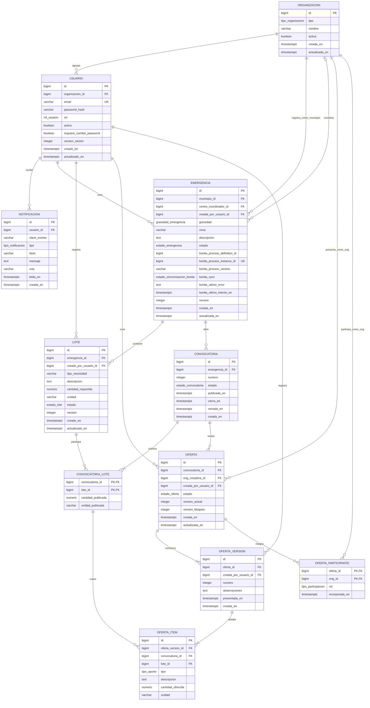
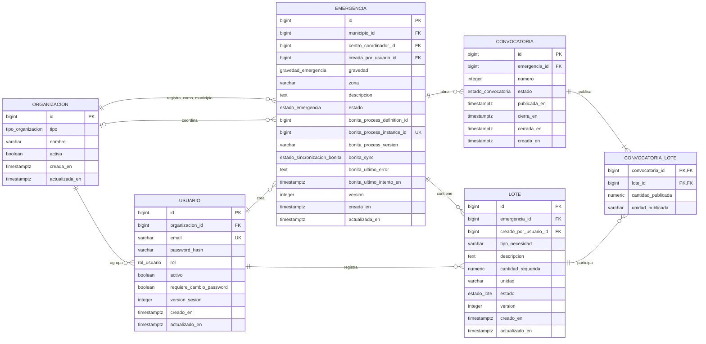
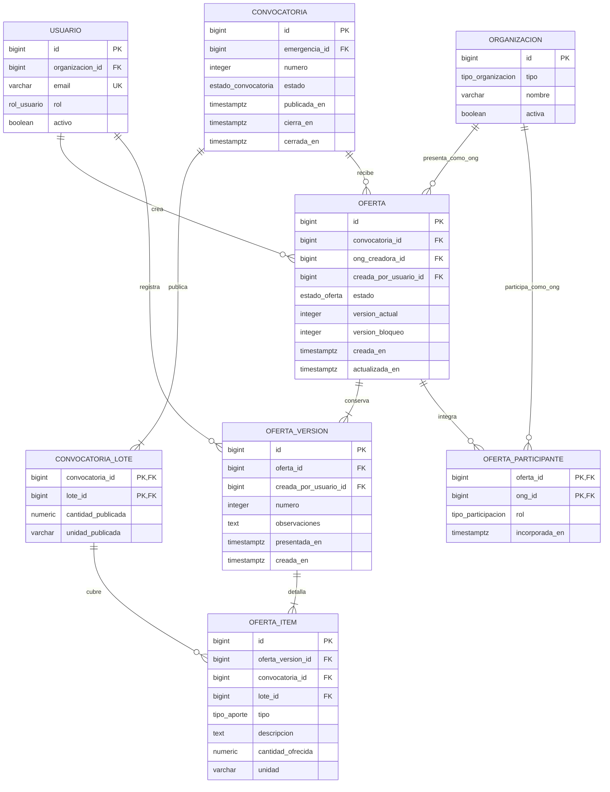

# Modelo de base de datos de RescueSync

## Modelo relacional vigente para la Entrega 2

**Motor:** PostgreSQL 16

**Persistencia:** SQLAlchemy 2.x y Alembic

**Alcance:** autenticación local, emergencias, lotes, convocatorias, ofertas e integración inicial con Bonita

## 1. Objetivo

Este documento describe el modelo relacional vigente de RescueSync a partir de los
requisitos de [`Trabajo integrador 2026.pdf`](<./Trabajo integrador 2026.pdf>),
[`Grooming Etapa 2.pdf`](<./Grooming Etapa 2.pdf>) y el proceso desplegable
[`RescueSync-1.2.bar`](./RescueSync-1.2.bar). El proyecto fuente `.bos` no está
disponible en el repositorio.

El modelo busca cubrir:

- Organizaciones, usuarios, los cuatro roles operativos y el rol administrador.
- Registro de emergencias por un municipio.
- Asignación y seguimiento por un Centro Coordinador Regional.
- Creación y publicación de lotes de necesidades.
- Ventanas de convocatoria administradas por Bonita.
- Ofertas básicas, parciales y preparadas para consorcios.
- Historial inmutable de versiones de ofertas.
- Vinculación y reconciliación con una instancia de Bonita.
- Restricciones y transacciones que eviten inconsistencias concurrentes.
- Buzones durables para las novedades entregadas en tiempo real.

No se incluyen inventario nacional, certificaciones, JWT del Sistema Nacional
ni bloqueo global de recursos. Esos componentes corresponden a la Entrega 3.

## 2. Principios de diseño

1. **PostgreSQL local es la fuente de verdad.** Emergencias, lotes,
   convocatorias, ofertas y sus borradores se almacenan localmente.
2. **Bonita conserva la orquestación.** La base local guarda la referencia de
   la instancia, pero no duplica los timers ni intenta reemplazar el motor BPM.
3. **Los permisos se validan en FastAPI.** Las restricciones visuales del
   frontend y los actores de Bonita no reemplazan la autorización del backend.
4. **Los estados se representan con enums.** No se utilizan strings dispersos
   para roles ni transiciones del negocio.
5. **Las ofertas tienen historia real.** Un número de control optimista no
   reemplaza las versiones inmutables de una oferta.
6. **No se borran registros operativos aplicados.** Las cancelaciones se
   representan mediante estados para preservar trazabilidad.
7. **Todos los timestamps son `timestamptz` en UTC.**

## 3. Diagrama entidad-relación



`CONVOCATORIA_LOTE` conserva la composición exacta de cada ronda. Esto permite
reabrir una convocatoria con los mismos lotes o publicar una reformulación sin
perder qué cantidades fueron visibles en cada ventana.

`OFERTA_PARTICIPANTE` puede incorporarse después de la oferta básica. En la
Entrega 2, `OFERTA.ong_creadora_id` es suficiente para una propuesta individual;
la tabla de participantes deja preparado el modelo para consorcios sin alterar
la identidad ni las versiones de la oferta.

### 3.1. Vista detallada de identidad, emergencias y publicación



### 3.2. Vista detallada de ofertas y versionado



## 4. Catálogos y enums

Los nombres definitivos deben compartirse entre SQLAlchemy, Pydantic y
TypeScript. Se propone comenzar con los siguientes valores.

### `tipo_organizacion`

```text
MUNICIPIO
CENTRO_COORDINADOR
ONG
```

### `rol_usuario`

```text
OPERADOR_MUNICIPAL
COORDINADOR_REGIONAL
REPRESENTANTE_ONG
AUDITOR_DIRECTIVO
ADMINISTRADOR
```

### `gravedad_emergencia`

```text
BAJA
MEDIA
ALTA
CRITICA
```

El enunciado no fija una escala exacta. La migración inicial adopta estos cuatro
valores; cualquier cambio posterior debe realizarse mediante una migración
correctiva que preserve los datos existentes.

### `estado_emergencia`

```text
REGISTRADA
EN_COORDINACION
PUBLICADA
EN_EVALUACION
EN_EJECUCION
RESUELTA
CANCELADA
```

Para la Entrega 2 son indispensables `REGISTRADA` y `PUBLICADA`. Los demás
valores representan las transiciones ya presentes en el proceso BPM.

### `estado_sincronizacion_bonita`

```text
PENDIENTE
VINCULADA
ERROR
RESULTADO_DESCONOCIDO
```

`RESULTADO_DESCONOCIDO` representa un timeout ocurrido después de enviar el
POST de instanciación. En ese estado se debe reconciliar por `idEmergencia`
antes de intentar crear otra instancia.

### `estado_lote`

```text
BORRADOR
PUBLICADO
CERRADO
CANCELADO
```

Un lote publicado no debe editarse. Una reformulación crea un nuevo lote o una
nueva asociación de convocatoria para conservar la versión anterior.

### `estado_convocatoria`

```text
ABIERTA
CERRADA
CANCELADA
```

Solo puede existir una convocatoria `ABIERTA` por emergencia.

### `estado_oferta`

```text
BORRADOR
PRESENTADA
EN_VALIDACION
VALIDADA
ADJUDICADA
NO_ADJUDICADA
RETIRADA
```

La Entrega 2 utiliza principalmente `BORRADOR` y `PRESENTADA`. Los estados de
validación y adjudicación quedan alineados con el proceso posterior.

### `tipo_aporte`

```text
RECURSO
PERSONAL
MIXTO
```

### `tipo_participacion`

```text
LIDER
MIEMBRO
```

## 5. Descripción de las entidades

### 5.1. `organizacion`

Representa municipios, Centros Coordinadores y ONGs. El tipo determina qué
roles y operaciones pueden corresponderle.

Reglas principales:

- `nombre` no puede ser vacío.
- `tipo` y `nombre` deberían ser únicos en conjunto si dos organizaciones de
  distinto tipo pueden compartir una denominación.
- Una organización inactiva no puede iniciar operaciones nuevas.
- No se elimina una organización que tenga emergencias u ofertas históricas.

### 5.2. `usuario`

Contiene las credenciales y el rol local. La cookie de sesión solo incluye el
identificador y la versión de sesión; en cada petición se recuperan desde la
base su organización, rol y estado vigentes.

Reglas principales:

- `email` es único sin distinguir mayúsculas y minúsculas.
- `password_hash` almacena exclusivamente un hash Argon2 generado con `pwdlib`.
- `requiere_cambio_password` restringe una credencial temporal hasta que el
  usuario la reemplace.
- `version_sesion` es positiva y se incrementa para invalidar cookies emitidas.
- Los operadores municipales pertenecen a un municipio.
- Los coordinadores pertenecen a un Centro Coordinador.
- Los representantes pertenecen a una ONG.
- Auditor/Directivo y Administrador no pertenecen a una organización.

La compatibilidad entre rol y tipo de organización debe validarse en el servicio
y, si se quiere una garantía estricta en PostgreSQL, mediante un trigger. Un
`CHECK` ordinario no puede consultar otra tabla.

### 5.3. `emergencia`

Es la raíz del agregado principal. Guarda el municipio que la registra, el
Coordinador asignado, sus datos descriptivos, el estado general y la referencia
a Bonita.

Los campos de integración cumplen funciones distintas:

- `bonita_process_definition_id`: definición desplegada que se utilizó.
- `bonita_process_instance_id`: caso creado; debe ser único cuando no sea nulo.
- `bonita_process_version`: versión funcional del proceso, por ejemplo `1.2`.
- `bonita_sync`: resultado actual de la vinculación.
- `bonita_ultimo_error`: mensaje seguro y sin credenciales.
- `bonita_ultimo_intento_en`: momento UTC del último intento.

`version` permite control optimista cuando dos solicitudes intentan modificar
simultáneamente la emergencia.

### 5.4. `lote`

Describe una necesidad cuantificada de una emergencia: personal, alimentos,
vehículos, medicamentos u otro recurso.

Reglas principales:

- `cantidad_requerida > 0`.
- `tipo_necesidad` y `unidad` no pueden estar vacíos.
- El municipio de la emergencia no crea lotes si esa operación corresponde al
  Coordinador.
- Un lote en `BORRADOR` puede editarse.
- Un lote publicado no debe modificarse destructivamente.
- Todos los lotes asociados a una convocatoria pertenecen a su emergencia.

Se propone `numeric` en lugar de `integer` para soportar unidades divisibles,
sin perder la posibilidad de exigir cantidades enteras para determinados tipos
de personal mediante validación de dominio.

### 5.5. `convocatoria`

Representa una ventana concreta de recepción de ofertas. Una emergencia puede
tener varias rondas si el Coordinador decide reabrirla o reformular los lotes.

Reglas principales:

- `numero` es único dentro de la emergencia.
- `cierra_en > publicada_en`.
- `cerrada_en` es obligatorio cuando el estado es `CERRADA`.
- Existe como máximo una convocatoria abierta por emergencia.
- Bonita administra el timer; `cierra_en` es una proyección local para mostrar
  la fecha y rechazar ofertas tardías.

### 5.6. `convocatoria_lote`

Es la asociación entre una ronda de convocatoria y los lotes que publica.
Almacena la cantidad y unidad visibles en esa ronda como un snapshot.

Su clave primaria compuesta evita publicar dos veces el mismo lote en la misma
convocatoria. La publicación exige al menos una fila válida.

### 5.7. `oferta`

Representa la identidad estable de una propuesta. Pertenece a una convocatoria
y a la ONG que la creó.

`version_actual` apunta lógicamente a la última versión, mientras que
`version_bloqueo` se utiliza para detectar actualizaciones concurrentes. El
segundo campo nunca sustituye a `oferta_version`.

En la oferta básica, una ONG puede crear una propuesta que cubra uno o más lotes
de la convocatoria. La política sobre una o varias ofertas por ONG y
convocatoria debe definirse antes de agregar una restricción `UNIQUE`.

### 5.8. `oferta_version`

Conserva cada revisión de una oferta. Una edición crea una fila nueva en vez de
sobrescribir la anterior.

Reglas principales:

- `(oferta_id, numero)` es único.
- `numero` comienza en 1 y crece sin saltos dentro de una transacción.
- Las versiones anteriores son inmutables.
- `presentada_en` distingue una versión enviada de una versión que todavía se
  estaba preparando.
- La versión que Bonita consolida al cerrar la convocatoria queda identificada
  de forma estable.

### 5.9. `oferta_item`

Detalla cuánto ofrece una versión para un lote publicado.

Reglas principales:

- `cantidad_ofrecida > 0`.
- `(oferta_version_id, lote_id)` es único.
- El lote debe integrar la misma convocatoria que la oferta.
- La unidad debe ser compatible con la unidad publicada del lote.
- Una versión presentada tiene al menos un ítem.

La pertenencia a la misma convocatoria puede garantizarse con claves foráneas
compuestas adicionales o con un trigger de restricción. También debe validarse
dentro de la transacción del caso de uso.

### 5.10. `oferta_participante`

Permite que varias ONGs integren un consorcio sin cambiar la propiedad ni el
historial de la oferta. En la Entrega 2 puede posponerse hasta que exista el
segundo uso real; `ong_creadora_id` cubre la oferta individual básica.

Cuando se implemente:

- Solo una participante puede tener rol `LIDER`.
- Todas las participantes deben ser organizaciones activas de tipo `ONG`.
- La organización creadora debe estar incluida como líder.
- La aceptación o confirmación del consorcio puede requerir campos adicionales
  cuando se defina la experiencia de usuario.

## 6. Restricciones e índices de PostgreSQL

### Restricciones mínimas

- `NOT NULL` en todos los identificadores y campos obligatorios.
- `CHECK (cantidad_requerida > 0)`.
- `CHECK (cantidad_publicada > 0)`.
- `CHECK (cantidad_ofrecida > 0)`.
- `CHECK (version > 0)` y `CHECK (version_bloqueo > 0)`.
- `CHECK (cierra_en > publicada_en)`.
- `UNIQUE (bonita_process_instance_id)` cuando el valor no sea nulo.
- `UNIQUE (emergencia_id, numero)` en convocatorias.
- `UNIQUE (oferta_id, numero)` en versiones.
- `UNIQUE (oferta_version_id, lote_id)` en ítems.
- Claves foráneas explícitas para todas las relaciones del diagrama.

### Índices recomendados

```text
usuario(lower(email)) UNIQUE
emergencia(municipio_id, estado)
emergencia(centro_coordinador_id, estado)
emergencia(bonita_sync)
lote(emergencia_id, estado)
convocatoria(emergencia_id, estado)
oferta(convocatoria_id, estado)
oferta(ong_creadora_id, estado)
oferta_version(oferta_id, numero DESC)
oferta_item(lote_id)
```

Crear además un índice único parcial para una sola convocatoria abierta:

```sql
CREATE UNIQUE INDEX uq_convocatoria_abierta_por_emergencia
ON convocatoria (emergencia_id)
WHERE estado = 'ABIERTA';
```

La migración inicial materializa este índice con el enum
`estado_convocatoria`.

## 7. Transacciones críticas

### 7.1. Registrar una emergencia e iniciar Bonita

1. Validar al Operador Municipal y su organización.
2. Insertar la emergencia como `REGISTRADA` y `bonita_sync = PENDIENTE`.
3. Confirmar la transacción local.
4. Iniciar Bonita con `idEmergencia`, `gravedad` y `zona`.
5. En una nueva transacción, guardar el ID y pasar a `VINCULADA`.
6. Ante un rechazo definitivo, guardar `ERROR`.
7. Ante un timeout incierto, guardar `RESULTADO_DESCONOCIDO` y reconciliar antes
   de reintentar.

No se debe mantener una transacción de PostgreSQL abierta durante una llamada
HTTP a Bonita.

### 7.2. Publicar una convocatoria

1. Bloquear la emergencia con `SELECT ... FOR UPDATE`.
2. Verificar autorización y estado compatible.
3. Bloquear y validar sus lotes en borrador.
4. Comprobar que exista al menos un lote con cantidad positiva.
5. Crear la convocatoria y sus filas `convocatoria_lote`.
6. Cambiar los lotes a `PUBLICADO` y la emergencia a `PUBLICADA`.
7. Confirmar todo en una única transacción.
8. Después del commit, completar la tarea correspondiente en Bonita.

Si falla Bonita después del commit, la publicación local no se pierde. Debe
registrarse un estado de sincronización operativo que permita reconciliar la
tarea.

### 7.3. Registrar o editar una oferta

1. Bloquear la convocatoria y verificar que siga `ABIERTA`.
2. Comprobar que la hora UTC actual sea anterior a `cierra_en`.
3. Verificar que el usuario represente a la ONG creadora.
4. Validar que todos los lotes integren esa convocatoria.
5. Insertar la oferta si es nueva.
6. Insertar una nueva `oferta_version` y sus ítems.
7. Actualizar `version_actual` y `version_bloqueo`.
8. Confirmar de forma atómica.

La restricción única de número de versión y el bloqueo de la oferta evitan que
dos ediciones concurrentes creen la misma versión.

### 7.4. Cerrar y consolidar ofertas

1. Bonita vence el timer e invoca una operación interna de FastAPI.
2. FastAPI bloquea la convocatoria.
3. Si ya está cerrada, responde idempotentemente con el mismo consolidado.
4. Cambia el estado a `CERRADA` y registra `cerrada_en`.
5. Selecciona la última versión presentada de cada oferta.
6. Devuelve el consolidado sin incluir borradores.

Cerrar y seleccionar el snapshot dentro de la misma transacción evita que una
última edición quede incluida solo parcialmente.

## 8. Correspondencia con los endpoints de la Entrega 2

| Endpoint | Tablas principales | Resultado |
|---|---|---|
| `POST /api/v1/emergencias` | `emergencia` | Crea una emergencia `REGISTRADA` y prepara su vinculación con Bonita. |
| `GET /api/v1/emergencias` | `emergencia`, `organizacion` | Filtra por organización, rol y estado. |
| `POST /api/v1/emergencias/{id}/reintentar-bonita` | `emergencia` | Reintenta o reconcilia la vinculación sin duplicar un caso cuyo resultado era incierto. |
| `POST /api/v1/emergencias/{id}/lotes` | `lote` | Crea o edita lotes en `BORRADOR`. |
| `GET /api/v1/emergencias/{id}/lotes` | `lote`, `convocatoria_lote` | Lista lotes y distingue borradores de publicados. |
| `POST /api/v1/emergencias/{id}/publicar` | `emergencia`, `convocatoria`, `convocatoria_lote`, `lote` | Publica al menos un lote de forma atómica. |
| `GET /api/v1/convocatorias` | `convocatoria`, `emergencia`, `convocatoria_lote`, `lote` | Lista ventanas abiertas y sus necesidades. |
| `POST /api/v1/ofertas` | `oferta`, `oferta_version`, `oferta_item` | Registra una oferta sobre lotes publicados. |
| `GET /api/v1/ofertas` | `oferta`, `oferta_version` | Devuelve las ofertas visibles para la ONG autenticada. |

`GET /api/v1/convocatorias` es una representación HTTP; la existencia de la
tabla no obliga a exponer internamente todas sus columnas.

## 9. Orden recomendado de implementación

1. Definir enums compartidos y confirmar la escala de gravedad.
2. Crear `organizacion` y `usuario`.
3. Crear `emergencia` con campos de sincronización Bonita.
4. Crear `lote`.
5. Crear `convocatoria` y `convocatoria_lote`.
6. Crear `oferta`, `oferta_version` y `oferta_item`.
7. Incorporar `oferta_participante` cuando se implemente el primer consorcio.
8. Revisar manualmente la migración Alembic, incluidos enums, checks, claves
   foráneas, índices parciales, `upgrade()` y `downgrade()`.
9. Probar sobre PostgreSQL real; no usar SQLite para estas invariantes.

## 10. Casos mínimos de prueba

### Seguridad y organizaciones

- Un Operador Municipal solo registra emergencias para su municipio.
- Un Coordinador no registra ofertas como ONG.
- Una ONG no modifica lotes.
- Un usuario inactivo no opera aunque conserve una cookie anterior.

### Emergencias y Bonita

- La emergencia nace como `REGISTRADA`.
- El ID de instancia Bonita no se repite.
- Un timeout conserva la emergencia y pasa a `RESULTADO_DESCONOCIDO`.
- La reconciliación no crea una segunda instancia.

### Lotes y publicación

- No se aceptan cantidades nulas, cero o negativas.
- No se publica una emergencia sin lotes válidos.
- La publicación crea una convocatoria y su snapshot en una transacción.
- Dos publicaciones concurrentes no crean dos convocatorias abiertas.
- Un lote publicado no se modifica destructivamente.

### Ofertas y versiones

- Una oferta solo referencia lotes de su convocatoria.
- Una oferta requiere al menos un ítem con cantidad positiva.
- Una ONG no ve ni edita borradores de otra ONG.
- Una edición crea una versión nueva y conserva la anterior.
- Dos ediciones concurrentes no reciben el mismo número de versión.
- Una convocatoria cerrada rechaza nuevas ofertas y ediciones.
- El consolidado excluye versiones no presentadas.

## 11. Decisiones adoptadas en la migración inicial

La revisión `20260915_0001` materializa las siguientes decisiones para la
Entrega 2:

- Las claves primarias son `bigint` autoincrementales.
- La gravedad admite `BAJA`, `MEDIA`, `ALTA` y `CRITICA`.
- Cada usuario posee un único rol local. Los roles operativos requieren una
  organización del tipo correspondiente; Auditor/Directivo y Administrador no
  pertenecen a una organización.
- La revisión `20260917_0002` incorpora el administrador, el cambio obligatorio
  de contraseñas temporales y el versionado de sesiones.
- Una ONG puede registrar más de una oferta en una convocatoria. Cada oferta
  conserva su propia secuencia inmutable de versiones.
- Las unidades se almacenan como texto no vacío. La compatibilidad entre
  unidades corresponde al caso de uso hasta que exista un catálogo acordado.
- La duración no tiene un valor implícito en la base: al publicar, el caso de
  uso debe informar `publicada_en` y `cierra_en` con zona horaria.
- Una reapertura crea una convocatoria con un nuevo `numero`; el índice parcial
  garantiza que solo exista una convocatoria `ABIERTA` por emergencia.

Cualquier cambio sobre estas decisiones requiere una migración correctiva; no
se modifica una revisión que ya pueda haberse aplicado en otro ambiente.

## 12. Validación del esquema y la migración

Alembic importa el paquete completo de modelos antes de asignar
`target_metadata`. La migración inicial debe validarse sobre PostgreSQL 16 con
el siguiente ciclo en una base descartable:

```bash
alembic upgrade head
alembic check
alembic downgrade base
alembic upgrade head
pytest tests/test_database_models.py
```

Las pruebas verifican la metadata registrada, las relaciones del flujo básico,
los timestamps con zona horaria y las restricciones relacionales que requieren
triggers de PostgreSQL.
